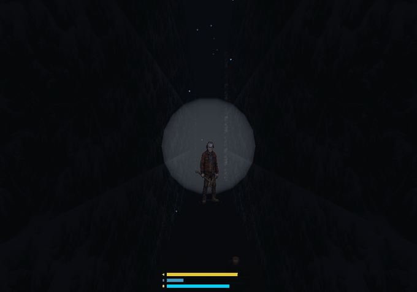
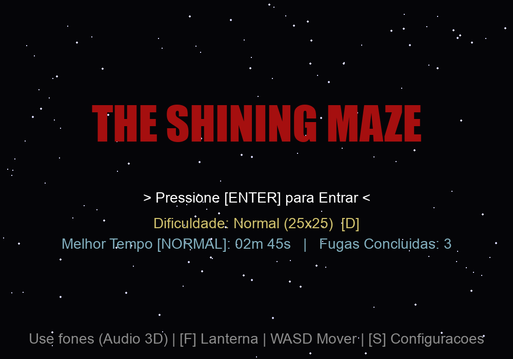
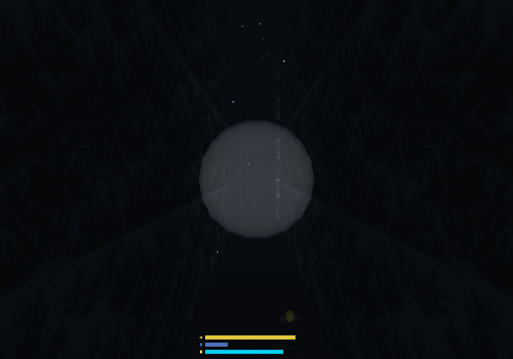
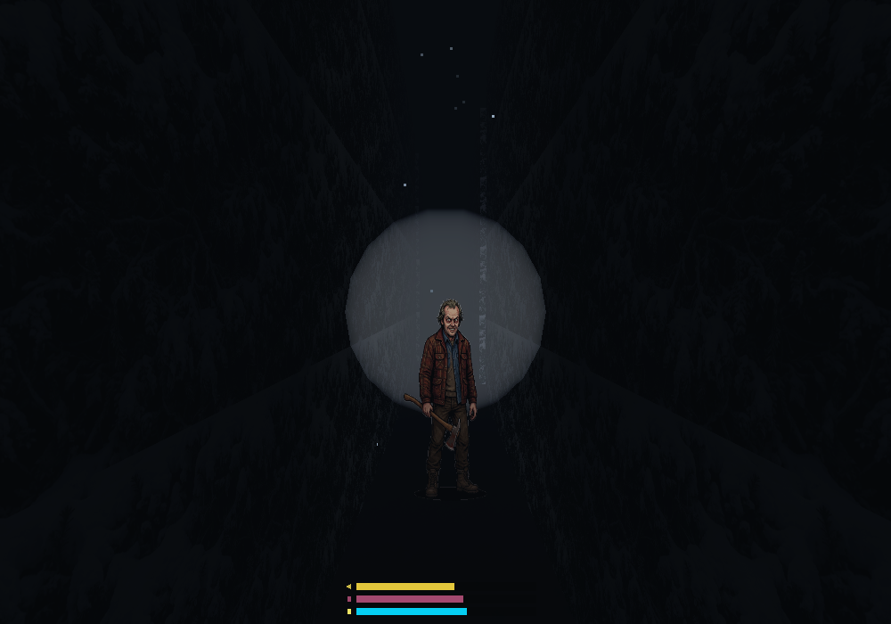
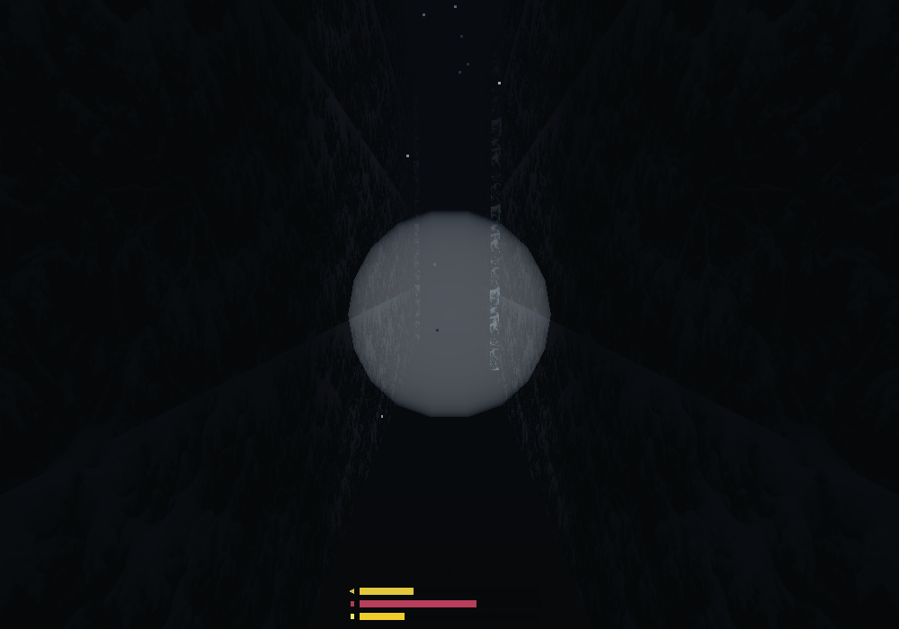

# The Shining Maze 🪓❄️

Um jogo de terror e sobrevivência em primeira pessoa desenvolvido em **Python** e **OpenGL (PyOpenGL / Pygame)** para a disciplina de **Computação Gráfica** (Universidade Federal da Grande Dourados - UFGD).

> [!IMPORTANT]
> **Aviso Legal e Tributo**: Este projeto é um **fan game** acadêmico e sem fins lucrativos, inspirado na obra cinematográfica *The Shining* (O Iluminado, 1980) dirigida por **Stanley Kubrick**, baseada no romance de **Stephen King**. Todos os direitos autorais de personagens, marcas e conceitos derivados pertencem aos seus respectivos detentores (Warner Bros. Pictures e os herdeiros de Stanley Kubrick e Stephen King). O projeto foi desenvolvido com finalidade estritamente educacional sob as diretrizes de *Fair Use* (Uso Justo).

---

## 🎮 Gameplay

<div align="center">
  
</div>

### Galeria de Telas

| Menu Principal | Exploração no Labirinto |
| :---: | :---: |
|  |  |

| Perseguição de Jack Torrance | HUD de Sobrevivência e Nevasca |
| :---: | :---: |
|  |  |

---

## 📦 Downloads (Executáveis Pré-Compilados)

Você pode baixar os executáveis prontos para jogar diretamente na aba de [**Releases do GitHub**](https://github.com/Yoshi-404/the_shining_maze/releases):

* 🪟 **Windows**: Baixe o arquivo [`The_Shining_Maze.exe`](https://github.com/Yoshi-404/the_shining_maze/releases/latest/download/The_Shining_Maze.exe) e dê dois cliques para jogar (não requer Python instalado).
* 🍎 **macOS**: Baixe o arquivo [`The_Shining_Maze_macOS.zip`](https://github.com/Yoshi-404/the_shining_maze/releases/latest/download/The_Shining_Maze_macOS.zip), descompacte o arquivo `.app` e execute.
  > *Nota no macOS*: Como o aplicativo não possui assinatura de desenvolvedor da Apple, na primeira execução clique com o botão direito no `.app` e selecione **Abrir**, confirmando a inicialização no Gatekeeper.

---

## 1. Descrição do Projeto e Motivação

O projeto foi concebido para demonstrar a aplicação prática de técnicas fundamentais e avançadas de computação gráfica 3D em tempo real. Diferente de projetos acadêmicos simplificados, *The Shining Maze* implementa um pipeline completo que abrange:

* **Geometria Procedural Dinâmica**: O labirinto é gerado proceduralmente a cada partida através do algoritmo DFS (*Depth-First Search* randomizado), com garantia topológica de caminho resolúvel, saídas falsas e becos sem saída.
* **Otimização de Cena**: Implementação de *Frustum Culling* espacial em chunks 3D e remoção de faces internas (*Hidden Face Removal*), permitindo altas taxas de quadros mesmo em labirintos extensos.
* **Iluminação e Atmosfera de Terror**: Modelo de iluminação de alto contraste com foco móvel de lanterna (*Spotlight* GL), feixe volumétrico cortando o ar e escuridão ambiente densa.
* **Física de Colisão Contínua**: Resolução contínua de colisão entre o volume circular do jogador e os cubos (AABB) das sebes, com deslizamento suave de eixos em quinas.
* **Áudio Espacial 3D**: Atenuação por distância e espacialização estéreo calculada em tempo real com base no vetor de visão do ouvinte.
* **Simulação de Sobrevivência**: Fôlego (*Stamina*), Ansiedade psicológica (*Terror/Taquicardia*), Bateria da lanterna e Hipotermia por nevasca.

---

## 2. Conceitos de Computação Gráfica Implementados

### 2.1. Pipeline de Projeção Híbrida
* **Projeção em Perspectiva (`gluPerspective`)**: Utilizada para renderizar todo o ambiente tridimensional (sebes, neve, skybox, Jack Torrance e partículas). Garante a percepção real de profundidade, escala métrica e o encurtamento perspectivo (*foreshortening*) essencial para a imersão em primeira pessoa.
* **Projeção Ortográfica (`glOrtho`)**: Utilizada na camada de interface (*HUD 2D*), menus interativos, minimapa e telas de pausa/vitória. Mantém os elementos visuais estáticos e imunes a distorções causadas pela orientação da câmera.

### 2.2. Frustum Culling e Otimização em Chunks
* O labirinto é particionado em chunks espaciais de $5 \times 5$ blocos compilados em *Display Lists* na memória da GPU.
* A cada frame, os 6 planos de corte do frustum de visão (Esquerda, Direita, Inferior, Superior, Próximo e Distante) são extraídos normalizados através do produto matricial:
  $$\mathbf{Clip} = \mathbf{ModelView} \times \mathbf{Projection}$$
* Cada chunk realiza um teste de intersecção entre sua caixa delimitadora (*AABB*) e os planos do frustum com margem de segurança de $1.5\text{ m}$. Chunks fora da visão da câmera ou além do alcance da neblina são descartados antes da chamada de desenho.
* **Remoção de Faces Ocultas (*Hidden Face Removal*)**: Apenas as faces das paredes voltadas para corredores abertos são construídas e desenhadas, economizando até 70% dos polígonos internos do labirinto.

### 2.3. Iluminação, Spotlight e Efeito Volumétrico
* **Luz Ambiente Global**: Configurada via `GL_LIGHT_MODEL_AMBIENT` em níveis baixos `(0.015, 0.018, 0.025)` para simular a noite fechada de inverno.
* **Lanterna Portátil (`GL_LIGHT0`)**: Implementada como um *Spotlight* realista atrelado à posição e vetor de visão da câmera (`GL_SPOT_CUTOFF = 30.0^\circ`, `GL_SPOT_EXPONENT = 18.0`). Possui atenuação quadrática e componente especular que reflete nas folhas úmidas e no gelo.
* **Feixe Volumétrico**: Cone geométrico renderizado com *Alpha Blending* aditivo (`GL_SRC_ALPHA`, `GL_ONE`) e `glDepthMask(GL_FALSE)` que corta a escuridão e se intensifica dinamicamente durante tempestades de neve.

### 2.4. Mapeamento de Texturas e Prevenção de Z-Fighting
* **Piso de Neve Contínuo**: Textura repetida metricamente de acordo com a escala do bloco para evitar estiramento.
* **Decalques no Chão (Sangue, Pegadas, Saída, Baterias)**: Uso de `glPolygonOffset` e elevações sub-milimétricas no eixo Y para evitar cintilação de profundidade (*Z-fighting*) sobre a malha de neve.
* **Billboards 3D**: O perseguidor Jack Torrance, partículas de nevasca e baforadas de vapor frio são renderizados como *Billboards* orientados continuamente para o ângulo de visão do observador, com teste alfa (`glAlphaFunc`) para transparência de contornos.

### 2.5. Detecção de Colisão Contínua (Círculo vs. AABB)
* A colisão do jogador (`raio = 0.35 m`) é calculada contra as caixas alinhadas aos eixos (*AABB*) das células vizinhas usando a projeção do ponto mais próximo:
  $$x_{\text{closest}} = \max(x_{\min}, \min(x, x_{\max})), \quad z_{\text{closest}} = \max(z_{\min}, \min(z, z_{\max}))$$
* Essa abordagem elimina quinas cegas, túneis de teletransporte e o viés de arredondamento (*banker's rounding*), garantindo deslizamento suave ao longo das sebes.

---

## 3. Controles do Jogo

| Comando | Tecla / Ação | Descrição |
| :--- | :---: | :--- |
| **Movimentação** | `W`, `A`, `S`, `D` | Caminha pelo labirinto |
| **Olhar / Mirar** | `Mouse` | Rotação de câmera (Yaw e Pitch) |
| **Correr (Sprint)** | `Shift` (Segurar) | Aumenta a velocidade em 1.65x (consome *Stamina*) |
| **Lanterna** | `F` | Liga e desliga a lanterna |
| **Menu de Pausa** | `ESC` | Congela a cena e abre ajustes de áudio e sensibilidade |
| **Dificuldade** | `D` ou `Tab` *(no Menu)* | Alterna entre Fácil (19x19), Normal (25x25) e Difícil (31x31) |
| **Configurações** | `S` *(no Menu)* | Ajustes de FOV, sensibilidade, volume e acessibilidade |

---

## 4. Indicadores da Interface (HUD)

O HUD inferior apresenta três barras dinâmicas de sobrevivência:
1. **Barra Superior (Âmbar / Dourado)**: **Fôlego (Stamina)**. Drena durante a corrida contínua (~4.5s) e se recupera ao caminhar ou parar. Ao zerar, o jogador entra em fadiga temporária.
2. **Barra Central (Violeta $\rightarrow$ Rubi Pulsante)**: **Ansiedade / Medo**. Sobe na escuridão profunda sem lanterna, na presença próxima do Jack ou em sustos. Ao atingir o ápice, provoca taquicardia e tremor de câmera. Pode ser aliviada ao se aproximar de **fogueiras** acesas ou da saída.
3. **Barra Inferior (Ciano Elétrico com LED)**: **Bateria da Lanterna**. Drena enquanto a luz estiver ligada (~80s). Deve ser recarregada coletando os cilindros de bateria 3D espalhados pelo chão.

---

## 5. Estrutura do Código-Fonte

```
the_shining_maze/
├── main.py                     # Loop principal, máquina de estados, colisão contínua e lógica de jogo
├── requirements.txt            # Dependências do projeto (Pygame, PyOpenGL, NumPy, PyInstaller)
├── .gitignore                  # Filtro de compilação, binários e dados locais
├── docs/
│   └── images/                 # Gameplay GIF e screenshots da documentação
├── assets/
│   ├── textures/               # Texturas (hedge.png, snow.png, skybox.png, jack.png, corpse.png)
│   ├── sounds/                 # Áudios (footstep, heartbeat, wind, whisper, drip, battery, click)
│   └── scripts/
│       └── gen_sounds.py       # Script matemático de síntese procedural de áudio WAV
└── game/
    ├── __init__.py
    ├── settings.py             # Configurações globais, presets de dificuldade e persistência de dados
    ├── maze_gen.py             # Algoritmo DFS procedural e posicionamento de saídas e corpos
    ├── renderer.py             # Chunks, Frustum Culling, iluminação, skybox, lanterna e billboards 3D
    └── effects.py              # Partículas de neve, pegadas, HUD de 3 níveis e aberração cromática
```

---

## 6. Instruções de Instalação e Execução (Via Código-Fonte)

### Pré-requisitos
* **Python 3.10+** instalado.

### 1. Clonar o repositório
```bash
git clone https://github.com/Yoshi-404/the_shining_maze.git
cd the_shining_maze
```

### 2. Instalar as dependências
```bash
pip install -r requirements.txt
```
*(Opcional no Windows/Linux para aceleração em C: `pip install PyOpenGL_accelerate`)*

### 3. Executar o jogo
```bash
python main.py
```

---

## 7. Pipeline de CI/CD (GitHub Actions)

O repositório conta com uma pipeline automatizada (`.github/workflows/build_and_release.yml`) que:
1. Constrói o executável standalone do Windows (`The_Shining_Maze.exe`).
2. Constrói o aplicativo empacotado para macOS (`The_Shining_Maze_macOS.zip` contendo `The_Shining_Maze.app`).
3. Publica automaticamente os binários na seção de [**Releases**](https://github.com/Yoshi-404/the_shining_maze/releases) tanto em tags de versão (`v*`) quanto em pushes para a branch `main`.

---

## 8. Origem e Licenças dos Assets

Todos os recursos visuais e sonoros utilizados no projeto foram sintetizados proceduralmente, obtidos sob licenças livres de uso ou aplicados sob a prerrogativa de *Fair Use* para fins acadêmicos:

### 8.1. Áudio e Efeitos Sonoros
* **Síntese Procedural em Python (`assets/scripts/gen_sounds.py`)**:
  * `wind.wav`: Síntese de ruído dinâmico passa-baixa simulando vento gélido contínuo.
  * `footstep.wav`: Gerador de envelope duplo simulando o impacto do passo e compressão da neve.
  * `heartbeat.wav`: Síntese acústica com sub-harmônicos reproduzindo a sístole e diástole cardíaca (*lub-dub*).
  * `whisper1.wav` e `whisper2.wav`: Modulação estatística com curvas senoidais simulando sussurros ambientes.
  * `drip.wav`: Variação rápida de pitch (*frequency sweep* 400Hz → 1200Hz com decaimento exponencial curto) simulando gotas.
  * `exit.wav`: Oscilação harmônica em 60Hz com batimento indicando a proximidade da saída.
* **Amostras Sonoras e Efeitos Complementares**:
  * `battery.wav`, `click.wav`, `jumpscare.wav`, `grito.mp3`, `scare.mp3`: Efeitos sonoros sob licença **Creative Commons CC0 / CC-BY** (Freesound.org e bancos de domínio público).
  * `danny1.wav`, `danny2.wav`: Amostras curtas de diálogo do filme *The Shining* (1980, Warner Bros.), utilizadas para fins de ambientação temática em fan game acadêmico (*Fair Use*).

### 8.2. Texturas e Sprites
* `hedge.png`: Textura seamless de folhagem/arbustos em alta resolução (Domínio público / CC0).
* `snow.png`: Textura contínua de neve compacta e gelo (Domínio público / CC0).
* `skybox.png`: Panorama noturno nublado de tempestade invernal (Domínio público / CC0).
* `corpse.png`: Sprite 2D de sobrevivente congelado (Creative Commons CC-BY).
* `jack.png` e `jumpscare_jack.png`: Representação visual do antagonista Jack Torrance interpretado por Jack Nicholson no filme *The Shining* (1980, Stanley Kubrick / Warner Bros. Pictures), tratada como *billboard* 3D sob *Fair Use* educacional.
* `jumpscare_twins.png`: Representação das gêmeas Grady (*The Shining*, 1980), utilizada em sequências de pânico sob *Fair Use* educacional.
* `jumpscare_bug.png`: Efeito gráfico estilizado de alucinação (Domínio público / CC0).
